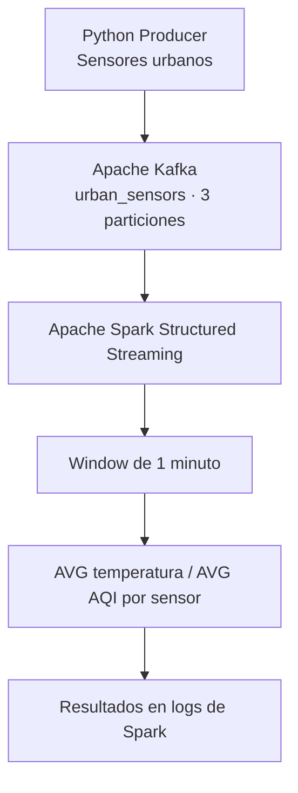

# Coderhouse Data Platform — Infraestructura Base

**Pre-entrega 1: Infraestructura Base con Entorno de Desarrollo e IAM Core**

## Descripción

Implementación de una infraestructura base para una plataforma de datos en AWS utilizando Terraform e Infrastructure as Code (IaC).

El proyecto establece los componentes de red, almacenamiento de estado remoto e identidad necesarios para futuras integraciones de procesamiento de datos mediante AWS Lambda, Amazon Kinesis y Apache Flink.

## Arquitectura

- **Terraform Backend:** Amazon S3 con cifrado SSE-S3 y versionado.
- **State Locking:** Amazon DynamoDB.
- **Networking:** VPC con dos subredes privadas en diferentes zonas de disponibilidad.
- **S3 Gateway Endpoint:** acceso a Amazon S3 desde las subredes privadas sin utilizar NAT Gateway.
- **IAM:** roles independientes para procesamiento de datos y auditoría.
- **Data Lake:** bucket S3 independiente del almacenamiento de estado de Terraform.

## Estructura del proyecto

```text
coderhouse-data-platform/
├── bootstrap/
│   └── bootstrap.ps1
├── modules/
│   ├── network/
│   │   ├── main.tf
│   │   ├── variables.tf
│   │   ├── outputs.tf
│   │   └── versions.tf
│   └── identity/
│       ├── main.tf
│       ├── variables.tf
│       ├── outputs.tf
│       └── versions.tf
├── environments/
│   └── dev/
│       ├── backend.tf
│       ├── providers.tf
│       ├── variables.tf
│       ├── main.tf
│       ├── storage.tf
│       ├── outputs.tf
│       └── .terraform.lock.hcl
├── .gitignore
├── PLAN_OUTPUT.md
└── README.md
```

## Requisitos

- Terraform 1.10 o superior.
- AWS CLI v2.
- Git.
- Cuenta AWS con permisos para administrar los recursos del proyecto.
- TFLint (recomendado).

## Configuración

La infraestructura utiliza la región `us-east-1` y el entorno `dev`.

El perfil local de AWS CLI se configura mediante:

```powershell
aws configure --profile coderhouse-dev
```

Verificación de identidad:

```powershell
aws sts get-caller-identity --profile coderhouse-dev
```

Las credenciales deben mantenerse fuera del repositorio.

## Backend remoto

El backend se almacena en:

- Bucket: `coderhouse-terraform-672049777597`
- Estado: `environments/dev/terraform.tfstate`
- Tabla DynamoDB: `coderhouse-terraform-locks`

El bucket utiliza cifrado SSE-S3, versionado y bloqueo de acceso público.

La tabla DynamoDB utiliza la clave de partición `LockID` y el modo `PAY_PER_REQUEST`.

**Nota:** el locking mediante DynamoDB está deprecado en Terraform, pero se mantiene para cumplir los requisitos del ejercicio. Para nuevas implementaciones se recomienda evaluar el locking nativo de S3.

Los recursos del backend deben crearse antes de inicializar Terraform. El directorio `bootstrap/` contiene el script de referencia; debe verificarse la existencia de los recursos antes de ejecutarlo para evitar conflictos.

## Infraestructura de red

La VPC utiliza el rango `10.10.0.0/16`.

| Recurso | Configuración |
|---|---|
| VPC | `10.10.0.0/16` |
| Subred privada 1 | `10.10.1.0/24` |
| Subred privada 2 | `10.10.2.0/24` |
| Tablas de rutas | Una por subred privada |
| Endpoint S3 | Gateway |
| NAT Gateway | No implementado |
| Internet Gateway | No implementado |

Las tablas de rutas privadas contienen rutas locales y una ruta hacia S3 mediante el Gateway Endpoint.

No se configuran rutas predeterminadas hacia internet.

## Seguridad e identidad

### Rol de procesamiento

`coderhouse-dev-processing`

Permite las siguientes operaciones:

- `s3:ListBucket`, limitado al prefijo `raw/`.
- `s3:GetObject`, sobre objetos dentro de `raw/`.
- `s3:PutObject`, sobre objetos dentro de `raw/`.

Bucket autorizado: `coderhouse-data-lake-672049777597`.

El rol está preparado como base para servicios Lambda y Flink. Los permisos adicionales requeridos para ejecución, logging o consumo de Kinesis se incorporarán en futuras etapas.

### Rol de auditoría

`coderhouse-dev-audit`

Permite consultar información de VPC, subredes, tablas de rutas, endpoints y metadatos seleccionados del Data Lake.

No incluye acciones de modificación de infraestructura.

## Despliegue

Desde el directorio `environments/dev`:

```powershell
terraform init
terraform fmt -check -recursive
terraform validate
terraform plan
terraform apply
```

Para consultar los identificadores de los recursos:

```powershell
terraform output
```

Para verificar diferencias posteriores:

```powershell
terraform plan
```

## Validaciones

La infraestructura fue desplegada y verificada mediante AWS CLI y Terraform.

Se comprobaron:

- Existencia de VPC y subredes privadas.
- Asociación del S3 Gateway Endpoint a ambas tablas de rutas privadas.
- Ausencia de rutas predeterminadas hacia internet.
- Políticas IAM limitadas según la función de cada rol.
- Estado remoto configurado en S3.
- Análisis estático mediante Terraform Validate y TFLint.
- Ausencia de diferencias entre el código y la infraestructura desplegada.

Resultado final de Terraform:

```text
No changes. Your infrastructure matches the configuration.
```

## Próximas etapas

La infraestructura permitirá incorporar servicios de ingesta, procesamiento y almacenamiento de datos mediante AWS Kinesis, AWS Lambda y Apache Flink.

## Consideraciones de costos

Se evita la creación de instancias EC2 y NAT Gateways. El S3 Gateway Endpoint no tiene cargo por hora.

El uso de S3, DynamoDB y otros servicios puede generar cargos según consumo. Se recomienda configurar alertas mediante AWS Budgets.

## Autor

Lopez Nicolas. Proyecto académico — Coderhouse, Data Engineering.

## Pre-entrega 2 — Ingesta de datos en tiempo real

### Objetivo

Implementar un pipeline de ingesta de eventos utilizando Amazon Kinesis Data Streams, Amazon Data Firehose y Amazon S3, administrado mediante Terraform.

### Arquitectura

```text
Producer Python (Boto3)
        |
        v
Kinesis Data Streams
PROVISIONED - 2 shards - KMS
        |
        v
Amazon Data Firehose
Buffer: 5 MiB / 60 segundos
        |
        v
Amazon S3 - Bronze Layer
ingesta/year=YYYY/month=MM/day=DD/
```

### Componentes implementados

- Kinesis Data Streams en modo Provisioned con dos shards y retención de 24 horas.
- Cifrado del stream mediante AWS KMS.
- Amazon Data Firehose como consumidor de Kinesis y destino S3.
- Rol IAM de Firehose con permisos para consumir eventos y escribir en el Data Lake.
- CloudWatch Logs para registrar errores de entrega.
- Alarmas para `ReadProvisionedThroughputExceeded` y `WriteProvisionedThroughputExceeded`.
- Producer Python que genera 100 transacciones ficticias utilizando UUID como claves de partición.

### Prueba de ingesta

Para ejecutar el producer:

```powershell
python -m pip install boto3
python scripts/producer.py
```

Resultado obtenido:

```text
Registros enviados: 100
Registros fallidos: 0
```

Se observaron registros asignados a los dos shards del stream.

### Ejemplo de envío mediante AWS CLI

```powershell
$evento = '{"transaction_id":"TX-1001","amount":15000,"status":"approved"}'
$bytes = [System.Text.Encoding]::UTF8.GetBytes($evento)
$base64 = [Convert]::ToBase64String($bytes)

aws kinesis put-record `
  --stream-name dev-transactions-stream `
  --partition-key "TX-1001" `
  --data $base64 `
  --region us-east-1 `
  --profile coderhouse-dev
```

### Evidencia de entrega en S3

Se verificó la creación de objetos dentro de:

`s3://coderhouse-data-lake-672049777597/ingesta/year=2026/month=10/day=21/`

Archivos observados:

| Archivo | Tamaño |
|---|---:|
| Evento inicial | 128 bytes |
| Lote de Firehose 1 | 8.260 bytes |
| Lote de Firehose 2 | 9.323 bytes |

Comando de verificación:

```powershell
aws s3 ls `
  s3://coderhouse-data-lake-672049777597/ingesta/ `
  --recursive `
  --profile coderhouse-dev
```

La prueba confirmó la recepción de 100 registros en Kinesis y la generación de archivos por Firehose en S3. El conteo exacto de registros persistidos se verifica por separado.

### Consideraciones

Las claves de partición variables permiten distribuir eventos entre shards y reducen el riesgo de hot shards.

La infraestructura de ingesta permanece desplegada temporalmente para reutilizarla en la siguiente etapa del proyecto. Los recursos provisionados pueden generar cargos mientras permanezcan activos.

## Pre-entrega 3 — Plataforma de Muestreo Urbano en Tiempo Real

### Objetivo

Implementar una plataforma de procesamiento de datos en tiempo real utilizando Kubernetes, Apache Kafka y Apache Spark Structured Streaming.

El sistema simula sensores urbanos que generan mediciones ambientales y calcula promedios de temperatura y calidad del aire por sensor en ventanas de un minuto.

### Arquitectura



### Componentes

**Kubernetes:** administra los Deployments, Services, ConfigMaps y el Job de inicialización del tópico.

**Kafka:** recibe eventos JSON en el tópico `urban_sensors`, configurado con tres particiones y factor de replicación 1.

**Python Producer:** simula cinco sensores urbanos y publica eventos cada dos segundos.

**Spark Structured Streaming:** consume Kafka y calcula los promedios de temperatura y calidad del aire por `sensor_id`, utilizando ventanas de tiempo de evento de un minuto y un watermark de dos minutos.

### Estructura

```text
k8s/
  namespace.yaml
  kafka-configmap.yaml
  kafka-deployment.yaml
  kafka-service.yaml
  kafka-topic-job.yaml
  spark-configmap.yaml
  spark-deployment.yaml
  producer-deployment.yaml

urban-producer/
  Dockerfile
  requirements.txt
  producer.py

spark/
  Dockerfile
  streaming_job.py

docs/evidence/
  producer-logs.txt
  spark-logs.txt
  kubernetes-pods.txt
```

### Requisitos

- Docker Desktop con Kubernetes habilitado.
- kubectl.
- Docker Engine funcionando.
- Recursos locales suficientes para ejecutar Kafka y Spark.

### Despliegue

Desde la raíz del repositorio:

**1. Construir las imágenes:**

```powershell
docker build -t urban-sensors-producer:1.0 ./urban-producer
docker build -t urban-spark-streaming:1.1 ./spark
```

**2. Crear namespace y configuración:**

```powershell
kubectl apply -f k8s/namespace.yaml
kubectl apply -f k8s/kafka-configmap.yaml
kubectl apply -f k8s/kafka-service.yaml
kubectl apply -f k8s/kafka-deployment.yaml
```

**3. Esperar a Kafka:**

```powershell
kubectl rollout status deployment/kafka -n urban-streaming --timeout=180s
```

**4. Crear el tópico:**

```powershell
kubectl apply -f k8s/kafka-topic-job.yaml
kubectl wait --for=condition=complete job/kafka-create-topic -n urban-streaming --timeout=120s
```

**5. Desplegar productor y Spark:**

```powershell
kubectl apply -f k8s/spark-configmap.yaml
kubectl apply -f k8s/producer-deployment.yaml
kubectl apply -f k8s/spark-deployment.yaml
```

**6. Verificar los componentes:**

```powershell
kubectl get pods -n urban-streaming
kubectl logs -n urban-streaming deployment/urban-producer --tail=20
kubectl logs -n urban-streaming deployment/urban-spark --tail=100
```

### Formato de eventos

```json
{
  "sensor_id": "sensor-002",
  "temperature": 27.9,
  "humidity": 65.2,
  "air_quality_index": 143,
  "timestamp": "2026-10-22T03:22:00Z"
}
```

### Evidencia del procesamiento

Spark procesó eventos del tópico Kafka y generó agregaciones por sensor.

Ejemplo real obtenido durante la prueba:

| Sensor | Temperatura promedio | AQI promedio | Eventos |
|---|---:|---:|---:|
| sensor-004 | 29.645 | 104.00 | 2 |
| sensor-005 | 28.703 | 77.67 | 3 |
| sensor-002 | 27.900 | 143.33 | 3 |
| sensor-001 | 30.225 | 92.00 | 2 |

Ventana: 2026-10-22 03:22:00–03:23:00 UTC.

Las evidencias completas se encuentran en `docs/evidence/`.

### Consideraciones técnicas

La implementación utiliza un broker Kafka en modo KRaft con tres particiones y replicación 1.

Spark se ejecuta en modo `local[2]` dentro de Kubernetes. Esto demuestra el procesamiento con Structured Streaming, pero no implementa un clúster Spark distribuido entre varios workers.

El almacenamiento de Kafka utiliza `emptyDir`, por lo que no está diseñado para persistencia ante reemplazos del Pod.

La solución está orientada a un laboratorio local y no debe considerarse una configuración de producción.

### Limpieza del entorno

Para eliminar los recursos Kubernetes del laboratorio:

```powershell
kubectl delete namespace urban-streaming
```

Esto elimina los recursos del namespace, pero no las imágenes Docker locales.


## Pre-entrega 4 — Procesamiento de transacciones en tiempo real con Apache Flink

### Objetivo

Implementar una capa de procesamiento de datos en tiempo real utilizando Amazon Managed Service for Apache Flink, consumiendo las transacciones del stream de Kinesis desarrollado en la Pre-entrega 2.

### Arquitectura

```text
Amazon Kinesis Data Streams
    dev-transactions-stream
            |
            v
Apache Flink 2.2
    |
    +-- Deserialización y validación JSON
    +-- Asignación de timestamps y watermarks
    +-- Filtrado de transacciones aprobadas
    +-- Agrupación por método de pago
    +-- Ventanas de tiempo de evento de 1 minuto
    +-- Cálculo de cantidad, total y promedio
            |
            v
    Sink: salida estándar
```

### Lógica de negocio

La aplicación procesa transacciones financieras en formato JSON con los campos `transaction_id`, `amount`, `payment_method`, `status` y `timestamp`.

El procesamiento consiste en:

1. Consumir eventos desde Amazon Kinesis Data Streams.
2. Deserializar y validar los registros JSON.
3. Descartar eventos inválidos y filtrar transacciones con estado `APPROVED`.
4. Agrupar las transacciones por método de pago.
5. Aplicar ventanas de un minuto mediante `TumblingEventTimeWindows`.
6. Calcular cantidad de transacciones, importe total e importe promedio por ventana y método de pago.

### WatermarkStrategy

Se utiliza una estrategia de tiempo de evento con tolerancia de 10 segundos para eventos fuera de orden.

Se configura una detección de inactividad de 30 segundos para evitar que las particiones inactivas bloqueen el avance de los watermarks.

La aplicación admite timestamps ISO 8601 y Unix epoch en milisegundos.

### Infraestructura Terraform

La aplicación se define mediante `aws_kinesisanalyticsv2_application`, utilizando el módulo `modules/managed-flink`.

El código Java se compila mediante Maven y se despliega como archivo JAR almacenado en Amazon S3.

La configuración incluye checkpoints habilitados para recuperación del estado del procesamiento.

### Paralelismo y KPUs

Configuración del entorno de desarrollo:

- Paralelismo: 1.
- Autoescalado: deshabilitado.
- Intervalo de checkpoints: 60 segundos.
- Pausa mínima entre checkpoints: 5 segundos.

Amazon Managed Service for Apache Flink administra los recursos mediante KPUs. La cantidad efectiva de KPUs depende de la configuración y asignación del servicio.

### Evidencia de ejecución

Se verificó la ejecución del job `Transactions Streaming Job` mediante el dashboard de Apache Flink.

Durante las pruebas se observaron:

- Job en estado `RUNNING`.
- Dos tareas activas.
- Consumo de registros desde Kinesis.
- Propagación de watermarks.
- 11 resultados emitidos por el operador de ventanas.
- 11 resultados recibidos por el sink.
- Checkpoints completados correctamente.

Las capturas del dashboard se utilizarán como evidencia del procesamiento.

### Consideraciones

La implementación utiliza un sink de salida estándar. No se incluye persistencia de las agregaciones en S3, dado que no es un requisito explícito de esta pre-entrega.

Los recursos administrados de AWS pueden generar costos mientras permanezcan activos.

## Pre-entrega 5 — Lakehouse con Apache Iceberg y AWS Glue

### Objetivo y arquitectura

Persistir las agregaciones por método de pago en una tabla transaccional
`lakehouse_db.transaction_aggregates`, reutilizando Kinesis, el bucket y la
aplicación Managed Flink de la Pre-entrega 4.

```text
Kinesis dev-transactions-stream (2 shards)
  → Flink 2.2: JSON válido → watermarks → approved → ventanas de 1 minuto
  → agregados → Iceberg format v2 / Parquet
  → S3 lakehouse/ + AWS Glue Data Catalog
  → Athena engine 3 / AwsDataCatalog
```

Se conserva también la salida estándar. Servicios: Kinesis Data Streams,
Managed Service for Apache Flink, S3, Glue Data Catalog, IAM, CloudWatch y Athena.
No se agregan un crawler, Glue ETL, DynamoDB de locking Iceberg ni otro bucket.

### Estructura y recursos reutilizados

| Consigna | Ubicación real | Responsabilidad |
|---|---|---|
| `infra/` | `modules/` + `environments/dev/` | Terraform modular incremental |
| `app/` | `applications/flink-transactions/` | Aplicación Java existente |
| Evidencias | `docs/evidence/` | Resultados reales de comandos y pruebas |
| Procedimiento AWS | `docs/iceberg-deployment.md` | Despliegue, consultas, cierre |

Estas equivalencias satisfacen la separación infraestructura/aplicación sin
mantener dos copias de los mismos recursos. `modules/lakehouse` declara la base
Glue, ubicación, catálogo y outputs; el módulo Managed Flink agrega permisos y
propiedades. Se reutiliza el versionado S3 existente, confirmado `Enabled` en AWS.

Terraform **administra la infraestructura necesaria para la tabla**, no su
puntero mutable `metadata_location`. El esquema, particionado y propiedades se
declaran en `IcebergLakehouse.java`; al enviar el job, la API Iceberg crea la
tabla si falta y rechaza esquemas incompatibles si ya existe. No se crea una
tabla Glue genérica sin metadatos Iceberg válidos, ni se usa un crawler para
actualizar sus metadatos. La base debe existir previamente mediante Terraform.

### Compatibilidad y dependencias

| Componente | Versión elegida |
|---|---|
| Java | 17 |
| Flink API / runtime AWS | 2.2.1 / `FLINK-2_2` |
| Iceberg runtime Flink 2.2 | 1.12.0 |
| Kinesis Streams connector | 6.0.1-2.0 |
| AWS SDK v2 BOM | 2.54.17 |
| Hadoop client API/runtime | 3.4.2 |
| Jackson BOM | 2.17.2 |
| JUnit Jupiter | 5.11.4 |
| Aplicación | 1.1.0 |

La [matriz oficial Iceberg](https://iceberg.apache.org/multi-engine-support/)
asocia Flink 2.2 con Iceberg 1.12.0, publicado el 29/09/2026 según
[releases oficiales](https://iceberg.apache.org/releases/). Se resolvió el
artefacto `iceberg-flink-runtime-2.2:1.12.0` en Maven Central. No fue necesario
cambiar el runtime. AWS documenta la familia del conector Kinesis
[6.x para Flink 2.2](https://docs.aws.amazon.com/managed-flink/latest/java/flink-2-2.html);
se conserva el patch 6.0.1-2.0 ya usado por el proyecto.

El runtime Iceberg incluye GlueCatalog y S3FileIO. Se agregan módulos SDK
Glue/S3/STS/KMS/DynamoDB y Apache5 con una sola versión BOM, alineada con
[la release Iceberg 1.12.0](https://github.com/apache/iceberg/blob/apache-iceberg-1.12.0/gradle/libs.versions.toml).
La carga de los clientes Glue/S3/Kinesis se prueba sin peticiones AWS;
su integración real fue verificada en AWS el 04/11/2026. El módulo SDK DynamoDB permite cargar interfaces del factory
AWS; **no configura locking ni crea una tabla DynamoDB**. Se evita combinar el
bundle AWS con otra copia del SDK. Flink core y Table runtime son `provided`;
Hadoop cliente se incluye para las clases de configuración usadas por el loader,
pero la escritura productiva utiliza S3FileIO. ServicesResourceTransformer
conserva los proveedores de servicios. Jackson se alinea con BOM y RowData usa
el serializador interno de Flink, evitando Kryo genérico para las filas.

### Esquema y precisión

| Campo | Iceberg / Athena | Semántica |
|---|---|---|
| `window_start` | timestamp sin zona | Inicio inclusivo, UTC |
| `window_end` | timestamp sin zona | Fin exclusivo, UTC |
| `payment_method` | string | Método de pago |
| `transaction_count` | long / bigint | Cantidad de aprobadas |
| `total_amount` | decimal(38,2) | Suma exacta |
| `average_amount` | decimal(38,6) | Promedio, HALF_UP |

Todos los campos son obligatorios. Se usa BigDecimal desde la deserialización;
los eventos deben tener ID, método, estado, timestamp válido e importe no
negativo con centavos exactos y hasta 18 dígitos de precisión. No se redondean
silenciosamente fracciones de centavo. Un desbordamiento al convertir la suma
falla explícitamente en lugar de persistir nulos. Los datos inválidos generan
un warning sin imprimir el contenido completo de la transacción.

### Particionado y Partition Pruning

La transformación oculta `day(window_start)` agrupa ventanas por día UTC,
sin particionar por minuto ni por método de pago. Las consultas que filtran
rangos de `window_start` permiten a Iceberg descartar particiones diarias que
no coinciden antes de leer Parquet; los manifests y estadísticas ayudan a
omitir archivos adicionales. Se benefician consultas por día y por períodos
acotados. Un filtro solo por método no elimina particiones diarias.

Cada checkpoint puede cerrar archivos aunque no lleguen al target de 128 MiB.
Con bajo volumen y commits por minuto se generan archivos pequeños; el target
no es un mínimo. Se fija un writer en este laboratorio y se deja la compactación,
expiración de snapshots y limpieza de huérfanos como mantenimiento planificado.
No aplicar reglas de expiración S3 sobre archivos referenciados por Iceberg.
El versionado S3 también conserva versiones antiguas y aumenta almacenamiento.

### Catálogo, IAM y commits

- Catálogo: `org.apache.iceberg.aws.glue.GlueCatalog`.
- FileIO: `org.apache.iceberg.aws.s3.S3FileIO`.
- Warehouse: `s3://coderhouse-data-lake-672049777597/lakehouse`.
- Tabla: `s3://coderhouse-data-lake-672049777597/lakehouse/lakehouse_db/transaction_aggregates`.
- Runtime properties: KINESIS_STREAM_ARN, ICEBERG_WAREHOUSE, ICEBERG_DATABASE,
  ICEBERG_TABLE y AWS_REGION; también se aceptan variables de entorno locales.

El rol del job obtiene GetDatabase y Get/Create/UpdateTable para esa base/tabla
y sus ancestros Glue; acceso a objetos exclusivamente bajo el prefijo de la
tabla. Terraform conserva la responsabilidad de crear/actualizar la base.
No se habilita eliminación de tablas ni administración global del catálogo.

El sink estable `FlinkSink` hace append y coordina sus commits con checkpoints
exitosos. Producción: intervalo 60 s, pausa mínima 5 s, un checkpoint concurrente,
paralelismo 1 y autoescalado deshabilitado. Glue usa optimistic locking con
version IDs y reintentos de Iceberg; el SDK supera el mínimo 2.17.131 indicado
por la [documentación de integración AWS](https://iceberg.apache.org/docs/latest/aws/).
No se configura un lock manager adicional. La atomicidad de un commit no
implica deduplicación de los eventos de negocio.

Se preservan watermarks de 10 s, idleness de 30 s, ventanas de tiempo de evento
de un minuto y filtro approved. Eventos posteriores al watermark pueden ser
descartados como tardíos; no se incorporó deduplicación por transaction_id.
TRIM_HORIZON sigue siendo el inicio de una ejecución sin estado restaurado:
reprocesar históricos puede agregar filas repetidas. No se garantiza exactamente
una vez de extremo a extremo para nuevos jobs o replays. El cambio de double a
BigDecimal exige revisar migración de snapshots anteriores; el ensayo AWS
preparado utiliza SKIP_RESTORE_FROM_SNAPSHOT en el laboratorio.

### Despliegue y validación Athena

Procedimiento completo y comandos: [docs/iceberg-deployment.md](docs/iceberg-deployment.md).
Incluye permisos previos, compilación, plan, publicación de JAR 1.1.0 con clave
nueva, aplicación aprobada, arranque, lote controlado, verificación y detención.
No se ejecuta apply ni se inicia Flink sin aprobación de costos.
Al clonar, usar `-var='enable_ingestion=true'` al generar el plan para conservar
los recursos de ingesta existentes.

Consultas completas: [docs/iceberg-validation.sql](docs/iceberg-validation.sql).
Ejemplo que permite pruning:

```sql
SELECT window_start, payment_method, transaction_count, total_amount, average_amount
FROM lakehouse_db.transaction_aggregates
WHERE window_start >= TIMESTAMP '2026-11-04 00:00:00'
  AND window_start < TIMESTAMP '2026-11-05 00:00:00';
```

Athena engine 3 admite tablas Iceberg format v2 en Glue. Se limita el writer a
format v2 y tipos/Parquet básicos: no se asume soporte en Athena de todas las
funciones de la librería Iceberg 1.12.0. La consulta real fue exitosa en engine 3.
Ver [restricciones oficiales Athena](https://docs.aws.amazon.com/athena/latest/ug/querying-iceberg.html).

### Resultados reales y estado de aceptación

**Prueba completa AWS exitosa el 04/11/2026.** RunId `pe5_20261104_113142`.
Flink ejecutó el pipeline en AWS, confirmó el commit del checkpoint 2 y Athena
consultó la fila esperada. Se enviaron cuatro eventos al mismo shard: dos
aprobados, uno rechazado y un marcador rechazado que avanzó el watermark.

| Inicio UTC | Fin UTC | Método | Cantidad | Total | Promedio |
|---|---|---|---:|---:|---:|
| 2026-11-04 11:33:00 | 2026-11-04 11:34:00 | card_pe5_20261104_113142 | 2 | 30.30 | 15.150000 |

La ventana corresponde a 08:33–08:34 de Argentina. Athena ejecutó la consulta
`578d831f-7595-43c3-8c20-e7716ebd1307` con estado `SUCCEEDED` y engine 3.
El archivo Parquet tiene una fila agregada y 2101 bytes; la transformación
`day(window_start)` produjo la partición `window_start_day=2026-11-04`.

| Requisito | Resultado verificado |
|---|---|
| Terraform fmt y validate | Exitosos |
| Terraform desplegado | Base Glue y política lakehouse creadas; aplicación y lectura del JAR actualizadas |
| Plan final contra AWS | No changes; código de salida 0 |
| Maven clean package | BUILD SUCCESS |
| Pruebas automatizadas | 7 exitosas, 0 fallos, 0 errores |
| Contenido JAR | Dependencias requeridas presentes; Flink core/Table excluidos |
| Base/tabla Glue | lakehouse_db.transaction_aggregates registrada con table_type=ICEBERG |
| S3 | Parquet, manifests y JSON de metadatos presentes |
| Checkpoints | 1 y 2 completados en logs; commit de datos asociado al checkpoint 2 |
| Snapshot Iceberg | 8171898520026477263, format-version 2 |
| Glue metadata_location | Cambió de 00000 a 00001 tras el commit |
| Athena | Consultas de datos, snapshots y archivos SUCCEEDED |
| Concurrencia durante el ensayo | 0 eventos ERROR y ningún conflicto observado en el intervalo revisado |
| Cierre y costos | Flink detenido y confirmado READY el 04/11/2026 a las 08:36 de Argentina |

Resultados y enlaces a archivos reales: [docs/evidence/iceberg-validation-status.md](docs/evidence/iceberg-validation-status.md).
Resumen automatizado: [iceberg-aws-test-summary.json](docs/evidence/iceberg-aws-test-summary.json).
Las evidencias provienen de AWS CLI, Athena, Glue, S3 y CloudWatch; no son
capturas simuladas. No se obtuvieron capturas de consola porque Computer Use
no pudo verificar la URL de Chrome. La ausencia de errores en este ensayo no
constituye una prueba de carga ni una garantía frente a cualquier concurrencia.

Los permisos del operador fueron habilitados por el propietario mediante una
política administrada acotada. `scripts/iceberg-preflight.ps1` permite comprobar
accesos. Para repetir el ensayo con costos autorizados, ejecutar
`powershell -NoProfile -File scripts/iceberg-aws-smoke.ps1 -Run`: verifica el
resultado y usa finally para detener Flink, también si la prueba falla. Cada
repetición inicia sin el snapshot anterior y puede releer eventos retenidos;
aplican las limitaciones de duplicados documentadas arriba.

Rama de entrega: `feature/iceberg-lakehouse`, [Pull Request #1](https://github.com/nitotito/coderhouse-data-platform/pull/1).
El merge final requiere aprobación del propietario.

### Costos

La ejecución de Flink consume KPUs mientras está activa. Kinesis conserva sus
dos shards provisionados aun con Flink detenido. S3 cobra objetos, operaciones y
versiones; Athena las consultas; Glue y CloudWatch según su uso. Los commits
frecuentes generan metadatos y archivos pequeños. Tras el ensayo, detener Flink
y verificar READY. No ejecutar destroy ni borrar datos para reducir costos sin
una decisión explícita sobre retención y recursos compartidos.
