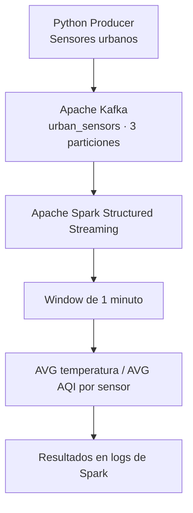

# Coderhouse Data Platform — Infraestructura Base

**Pre-entrega 1: Infraestructura Base con Entorno de Desarrollo e IAM Core**

## Descripción

Implementación de una infraestructura base para una plataforma de datos en AWS utilizando Terraform e Infrastructure as Code (IaC).

El proyecto establece los componentes de red, almacenamiento de estado remoto e identidad necesarios para futuras integraciones de procesamiento de datos mediante AWS Lambda, Amazon Kinesis y Apache Flink.

## Arquitectura

- **Terraform Backend:** Amazon S3 con cifrado SSE-S3 y versionado.
- **State Locking:** Amazon DynamoDB.
- **Networking:** VPC con dos subredes privadas en diferentes zonas de disponibilidad.
- **S3 Gateway Endpoint:** acceso a Amazon S3 desde las subredes privadas sin utilizar NAT Gateway.
- **IAM:** roles independientes para procesamiento de datos y auditoría.
- **Data Lake:** bucket S3 independiente del almacenamiento de estado de Terraform.

## Estructura del proyecto

```text
coderhouse-data-platform/
├── bootstrap/
│   └── bootstrap.ps1
├── modules/
│   ├── network/
│   │   ├── main.tf
│   │   ├── variables.tf
│   │   ├── outputs.tf
│   │   └── versions.tf
│   └── identity/
│       ├── main.tf
│       ├── variables.tf
│       ├── outputs.tf
│       └── versions.tf
├── environments/
│   └── dev/
│       ├── backend.tf
│       ├── providers.tf
│       ├── variables.tf
│       ├── main.tf
│       ├── storage.tf
│       ├── outputs.tf
│       └── .terraform.lock.hcl
├── .gitignore
├── PLAN_OUTPUT.md
└── README.md
```

## Requisitos

- Terraform 1.10 o superior.
- AWS CLI v2.
- Git.
- Cuenta AWS con permisos para administrar los recursos del proyecto.
- TFLint (recomendado).

## Configuración

La infraestructura utiliza la región `us-east-1` y el entorno `dev`.

El perfil local de AWS CLI se configura mediante:

```powershell
aws configure --profile coderhouse-dev
```

Verificación de identidad:

```powershell
aws sts get-caller-identity --profile coderhouse-dev
```

Las credenciales deben mantenerse fuera del repositorio.

## Backend remoto

El backend se almacena en:

- Bucket: `coderhouse-terraform-672049777597`
- Estado: `environments/dev/terraform.tfstate`
- Tabla DynamoDB: `coderhouse-terraform-locks`

El bucket utiliza cifrado SSE-S3, versionado y bloqueo de acceso público.

La tabla DynamoDB utiliza la clave de partición `LockID` y el modo `PAY_PER_REQUEST`.

**Nota:** el locking mediante DynamoDB está deprecado en Terraform, pero se mantiene para cumplir los requisitos del ejercicio. Para nuevas implementaciones se recomienda evaluar el locking nativo de S3.

Los recursos del backend deben crearse antes de inicializar Terraform. El directorio `bootstrap/` contiene el script de referencia; debe verificarse la existencia de los recursos antes de ejecutarlo para evitar conflictos.

## Infraestructura de red

La VPC utiliza el rango `10.10.0.0/16`.

| Recurso | Configuración |
|---|---|
| VPC | `10.10.0.0/16` |
| Subred privada 1 | `10.10.1.0/24` |
| Subred privada 2 | `10.10.2.0/24` |
| Tablas de rutas | Una por subred privada |
| Endpoint S3 | Gateway |
| NAT Gateway | No implementado |
| Internet Gateway | No implementado |

Las tablas de rutas privadas contienen rutas locales y una ruta hacia S3 mediante el Gateway Endpoint.

No se configuran rutas predeterminadas hacia internet.

## Seguridad e identidad

### Rol de procesamiento

`coderhouse-dev-processing`

Permite las siguientes operaciones:

- `s3:ListBucket`, limitado al prefijo `raw/`.
- `s3:GetObject`, sobre objetos dentro de `raw/`.
- `s3:PutObject`, sobre objetos dentro de `raw/`.

Bucket autorizado: `coderhouse-data-lake-672049777597`.

El rol está preparado como base para servicios Lambda y Flink. Los permisos adicionales requeridos para ejecución, logging o consumo de Kinesis se incorporarán en futuras etapas.

### Rol de auditoría

`coderhouse-dev-audit`

Permite consultar información de VPC, subredes, tablas de rutas, endpoints y metadatos seleccionados del Data Lake.

No incluye acciones de modificación de infraestructura.

## Despliegue

Desde el directorio `environments/dev`:

```powershell
terraform init
terraform fmt -check -recursive
terraform validate
terraform plan
terraform apply
```

Para consultar los identificadores de los recursos:

```powershell
terraform output
```

Para verificar diferencias posteriores:

```powershell
terraform plan
```

## Validaciones

La infraestructura fue desplegada y verificada mediante AWS CLI y Terraform.

Se comprobaron:

- Existencia de VPC y subredes privadas.
- Asociación del S3 Gateway Endpoint a ambas tablas de rutas privadas.
- Ausencia de rutas predeterminadas hacia internet.
- Políticas IAM limitadas según la función de cada rol.
- Estado remoto configurado en S3.
- Análisis estático mediante Terraform Validate y TFLint.
- Ausencia de diferencias entre el código y la infraestructura desplegada.

Resultado final de Terraform:

```text
No changes. Your infrastructure matches the configuration.
```

## Próximas etapas

La infraestructura permitirá incorporar servicios de ingesta, procesamiento y almacenamiento de datos mediante AWS Kinesis, AWS Lambda y Apache Flink.

## Consideraciones de costos

Se evita la creación de instancias EC2 y NAT Gateways. El S3 Gateway Endpoint no tiene cargo por hora.

El uso de S3, DynamoDB y otros servicios puede generar cargos según consumo. Se recomienda configurar alertas mediante AWS Budgets.

## Autor

Lopez Nicolas. Proyecto académico — Coderhouse, Data Engineering.

## Pre-entrega 2 — Ingesta de datos en tiempo real

### Objetivo

Implementar un pipeline de ingesta de eventos utilizando Amazon Kinesis Data Streams, Amazon Data Firehose y Amazon S3, administrado mediante Terraform.

### Arquitectura

```text
Producer Python (Boto3)
        |
        v
Kinesis Data Streams
PROVISIONED - 2 shards - KMS
        |
        v
Amazon Data Firehose
Buffer: 5 MiB / 60 segundos
        |
        v
Amazon S3 - Bronze Layer
ingesta/year=YYYY/month=MM/day=DD/
```

### Componentes implementados

- Kinesis Data Streams en modo Provisioned con dos shards y retención de 24 horas.
- Cifrado del stream mediante AWS KMS.
- Amazon Data Firehose como consumidor de Kinesis y destino S3.
- Rol IAM de Firehose con permisos para consumir eventos y escribir en el Data Lake.
- CloudWatch Logs para registrar errores de entrega.
- Alarmas para `ReadProvisionedThroughputExceeded` y `WriteProvisionedThroughputExceeded`.
- Producer Python que genera 100 transacciones ficticias utilizando UUID como claves de partición.

### Prueba de ingesta

Para ejecutar el producer:

```powershell
python -m pip install boto3
python scripts/producer.py
```

Resultado obtenido:

```text
Registros enviados: 100
Registros fallidos: 0
```

Se observaron registros asignados a los dos shards del stream.

### Ejemplo de envío mediante AWS CLI

```powershell
$evento = '{"transaction_id":"TX-1001","amount":15000,"status":"approved"}'
$bytes = [System.Text.Encoding]::UTF8.GetBytes($evento)
$base64 = [Convert]::ToBase64String($bytes)

aws kinesis put-record `
  --stream-name dev-transactions-stream `
  --partition-key "TX-1001" `
  --data $base64 `
  --region us-east-1 `
  --profile coderhouse-dev
```

### Evidencia de entrega en S3

Se verificó la creación de objetos dentro de:

`s3://coderhouse-data-lake-672049777597/ingesta/year=2026/month=10/day=21/`

Archivos observados:

| Archivo | Tamaño |
|---|---:|
| Evento inicial | 128 bytes |
| Lote de Firehose 1 | 8.260 bytes |
| Lote de Firehose 2 | 9.323 bytes |

Comando de verificación:

```powershell
aws s3 ls `
  s3://coderhouse-data-lake-672049777597/ingesta/ `
  --recursive `
  --profile coderhouse-dev
```

La prueba confirmó la recepción de 100 registros en Kinesis y la generación de archivos por Firehose en S3. El conteo exacto de registros persistidos se verifica por separado.

### Consideraciones

Las claves de partición variables permiten distribuir eventos entre shards y reducen el riesgo de hot shards.

La infraestructura de ingesta permanece desplegada temporalmente para reutilizarla en la siguiente etapa del proyecto. Los recursos provisionados pueden generar cargos mientras permanezcan activos.

## Pre-entrega 3 — Plataforma de Muestreo Urbano en Tiempo Real

### Objetivo

Implementar una plataforma de procesamiento de datos en tiempo real utilizando Kubernetes, Apache Kafka y Apache Spark Structured Streaming.

El sistema simula sensores urbanos que generan mediciones ambientales y calcula promedios de temperatura y calidad del aire por sensor en ventanas de un minuto.

### Arquitectura



### Componentes

**Kubernetes:** administra los Deployments, Services, ConfigMaps y el Job de inicialización del tópico.

**Kafka:** recibe eventos JSON en el tópico `urban_sensors`, configurado con tres particiones y factor de replicación 1.

**Python Producer:** simula cinco sensores urbanos y publica eventos cada dos segundos.

**Spark Structured Streaming:** consume Kafka y calcula los promedios de temperatura y calidad del aire por `sensor_id`, utilizando ventanas de tiempo de evento de un minuto y un watermark de dos minutos.

### Estructura

```text
k8s/
  namespace.yaml
  kafka-configmap.yaml
  kafka-deployment.yaml
  kafka-service.yaml
  kafka-topic-job.yaml
  spark-configmap.yaml
  spark-deployment.yaml
  producer-deployment.yaml

urban-producer/
  Dockerfile
  requirements.txt
  producer.py

spark/
  Dockerfile
  streaming_job.py

docs/evidence/
  producer-logs.txt
  spark-logs.txt
  kubernetes-pods.txt
```

### Requisitos

- Docker Desktop con Kubernetes habilitado.
- kubectl.
- Docker Engine funcionando.
- Recursos locales suficientes para ejecutar Kafka y Spark.

### Despliegue

Desde la raíz del repositorio:

**1. Construir las imágenes:**

```powershell
docker build -t urban-sensors-producer:1.0 ./urban-producer
docker build -t urban-spark-streaming:1.1 ./spark
```

**2. Crear namespace y configuración:**

```powershell
kubectl apply -f k8s/namespace.yaml
kubectl apply -f k8s/kafka-configmap.yaml
kubectl apply -f k8s/kafka-service.yaml
kubectl apply -f k8s/kafka-deployment.yaml
```

**3. Esperar a Kafka:**

```powershell
kubectl rollout status deployment/kafka -n urban-streaming --timeout=180s
```

**4. Crear el tópico:**

```powershell
kubectl apply -f k8s/kafka-topic-job.yaml
kubectl wait --for=condition=complete job/kafka-create-topic -n urban-streaming --timeout=120s
```

**5. Desplegar productor y Spark:**

```powershell
kubectl apply -f k8s/spark-configmap.yaml
kubectl apply -f k8s/producer-deployment.yaml
kubectl apply -f k8s/spark-deployment.yaml
```

**6. Verificar los componentes:**

```powershell
kubectl get pods -n urban-streaming
kubectl logs -n urban-streaming deployment/urban-producer --tail=20
kubectl logs -n urban-streaming deployment/urban-spark --tail=100
```

### Formato de eventos

```json
{
  "sensor_id": "sensor-002",
  "temperature": 27.9,
  "humidity": 65.2,
  "air_quality_index": 143,
  "timestamp": "2026-10-22T03:22:00Z"
}
```

### Evidencia del procesamiento

Spark procesó eventos del tópico Kafka y generó agregaciones por sensor.

Ejemplo real obtenido durante la prueba:

| Sensor | Temperatura promedio | AQI promedio | Eventos |
|---|---:|---:|---:|
| sensor-004 | 29.645 | 104.00 | 2 |
| sensor-005 | 28.703 | 77.67 | 3 |
| sensor-002 | 27.900 | 143.33 | 3 |
| sensor-001 | 30.225 | 92.00 | 2 |

Ventana: 2026-10-22 03:22:00–03:23:00 UTC.

Las evidencias completas se encuentran en `docs/evidence/`.

### Consideraciones técnicas

La implementación utiliza un broker Kafka en modo KRaft con tres particiones y replicación 1.

Spark se ejecuta en modo `local[2]` dentro de Kubernetes. Esto demuestra el procesamiento con Structured Streaming, pero no implementa un clúster Spark distribuido entre varios workers.

El almacenamiento de Kafka utiliza `emptyDir`, por lo que no está diseñado para persistencia ante reemplazos del Pod.

La solución está orientada a un laboratorio local y no debe considerarse una configuración de producción.

### Limpieza del entorno

Para eliminar los recursos Kubernetes del laboratorio:

```powershell
kubectl delete namespace urban-streaming
```

Esto elimina los recursos del namespace, pero no las imágenes Docker locales.
