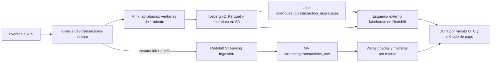

# Pre-entrega 6 - Analítica avanzada in-stream con Redshift

Autor: Nicolás López. Cuenta AWS: 672049777597. Región: us-east-1.
Rama: `feature/redshift-streaming-analytics`. **Prueba funcional y seguridad PASSED
en AWS el 07/11/2026. Ensayo único autorizado con retiro posterior del módulo
temporal. Capturas reales de eventos, métricas y JOIN incorporadas al PDF.**

## Objetivo y arquitectura

Consultar eventos recibidos directamente de Kinesis y contrastar sus agregaciones
con la tabla Iceberg de la entrega 5, desde una misma base Redshift.



Los datos recientes se definen por su llegada a Kinesis; pueden contener eventos
con event time histórico. No se unen filas transaccionales con agregados sin
agrupar primero. El JOIN es una comparación de dos mediciones del mismo conjunto,
no una suma ni una unión de historias solapadas.

## Inventario comprobado y compatibilidad

El 06/11/2026 se consultaron AWS STS, Glue, Kinesis, EC2 y S3 con el perfil
`coderhouse-dev`: cuenta 672049777597; VPC `vpc-0b85171c643372dba`;
subredes `subnet-0e484b46487a0220c` (us-east-1a) y
`subnet-001ae24851059e5ed` (us-east-1b), con 251 IP libres cada una.
Stream `dev-transactions-stream`: ACTIVE, 2 shards, retención 24 horas,
cifrado alias/aws/kinesis. Bucket `coderhouse-data-lake-672049777597`:
versionado Enabled. Flink `coderhouse-dev-transactions-flink`: READY.
Glue mantiene la tabla ICEBERG y el metadata_location del snapshot probado en PE5.

La primera consulta KMS DescribeKey fue denegada; el error identificó el ARN de la clave
`arn:aws:kms:us-east-1:672049777597:key/8cd750a2-438b-42dc-935d-24f3cb6855f4`.
Tras habilitar permisos, DescribeKey confirmó ese ARN y las consultas
ListWorkgroups/DescribeClusters devolvieron listas vacías. El primer apply fue
denegado por IAM/EC2; la política del operador se corrigió y el siguiente apply
creó los ocho recursos. El ensayo y su retiro fueron autorizados expresamente.
La política está en `docs/redshift-test-operator-access.json`.

Las pruebas reales PE5 están en [el índice anterior](evidence/iceberg-validation-status.md).
Son antecedentes, no resultados Redshift. La tabla tiene seis columnas y
agregados aprobados por `window_start`, `window_end`, `payment_method`, con
`transaction_count`, `total_amount decimal(38,2)` y `average_amount decimal(38,6)`.
Iceberg format-version 2 y Parquet son compatibles con lectura Redshift.
Serverless usa su propio cómputo para leer el lake; no se agrega el cargo Spectrum
por TB de los clusters provisionados RA3. No se crean estadísticas Glue de pago.

## Decisión de infraestructura y costos

Se elige Serverless de 4 RPU para un ensayo pequeño, sin reservas ni clúster
permanentemente encendido. Un provisionado permite pausa/reanudación, pero agrega
administración de nodos y capacidad menos flexible. Serverless **no tiene la
operación StopApplication de Flink**: deja de consumir cómputo al quedar inactivo,
pero el almacenamiento y PrivateLink siguen facturándose.

AWS admite dos AZ sin EVR desde julio de 2025. Se reutilizan las subredes existentes
sin modificar el módulo network. No hay NAT ni Internet Gateway en esas rutas:
se prepara un endpoint de interfaz Kinesis en ambas AZ, DNS privado, HTTPS y SG
de origen Redshift. Data API permite ejecutar SQL sin abrir TCP 5439 ni publicar
el workgroup. S3 gateway endpoint existente permanece igual; sin EVR las lecturas
del lake son administradas por Redshift. No se agregan endpoints Glue/KMS de pago.

Estimación orientativa on-demand us-east-1, consultada en páginas oficiales:

| Concepto | Configuración | Estimación USD sin impuestos |
|---|---|---|
| Redshift activo | Base y máximo 4 RPU, 0.375 USD/RPU-h | 1.50 por hora activa; 0.75 por 30 min |
| PrivateLink Kinesis | Dos AZ, 0.01 USD por AZ-h | 0.02/h mientras exista, más tráfico |
| Tráfico PrivateLink | Primer PB, 0.01 USD/GB | Despreciable para el lote pequeño; no cero garantizado |
| Límite diario | 8 RPU-h, acción deactivate | Aproximadamente 3 USD de cómputo; no un tope monetario absoluto |
| Almacenamiento | MV, metadatos y backups retenidos | Variable; medir, no se asume gratuito |

Se proyecta aproximadamente **0.77-1.52 USD para 30-60 minutos activos**, más
almacenamiento y tráfico, sin créditos ni impuestos. El endpoint cobra horas
parciales completas. Si permanece 730 horas: aproximadamente 14.60 USD/mes aun
sin consultas. El límite diario se reinicia y no cubre storage/endpoints ni
garantiza detener el gasto exactamente al centavo. Los cargos Kinesis/S3 previos
continúan; Flink no se inicia en la prueba propuesta.

## Terraform y despliegue

`terraform/redshift.tf` habilita `terraform/modules/redshift/` mediante
`enable_redshift=false` por defecto. Los ocho recursos nuevos son rol IAM,
política del rol, dos security groups, endpoint Kinesis, namespace, workgroup y
usage limit. El apply exitoso registró **8 altas, 0 cambios, 0 bajas**. Dos
ajustes posteriores afectaron únicamente la confianza del rol temporal hasta
verificar su funcionamiento con ExternalId. El retiro planifica exclusivamente
esas ocho bajas. El backend y las direcciones de entregas previas se conservan.

```powershell
terraform -chdir=terraform init
terraform -chdir=terraform fmt -check -recursive
terraform -chdir=terraform validate
terraform -chdir=terraform plan -var='enable_ingestion=true' -var='enable_redshift=true' `
  -var='redshift_kinesis_kms_key_arn=arn:aws:kms:us-east-1:672049777597:key/8cd750a2-438b-42dc-935d-24f3cb6855f4' `
  -out=checkpoint6.tfplan
# Solo después de revisar inventario, permisos, costo y recibir autorización:
terraform -chdir=terraform apply checkpoint6.tfplan
terraform -chdir=terraform output -json redshift
```

Antes del apply, confirmar ausencia o reutilización/importación de un workgroup
equivalente. No importar automáticamente otro warehouse sin revisar su dueño.
Tras el apply aprobado, conservar `enable_ingestion=true`, `enable_redshift=true`
y el ARN KMS en un tfvars local ignorado. Un plan futuro con el valor default
false propondría eliminar el módulo; no ejecutarlo sin aprobación específica.

## IAM, autenticación y rol SQL

El rol AWS `coderhouse-dev-analytics-execution` se confía a ambos principales
Redshift. La asunción SQL exige el ExternalId documentado de un usuario Serverless:
`arn:aws:redshift:us-east-1:672049777597:dbuser:serverless-672049777597-*/*`.
Restringe cuenta y región sin dependencia circular con el UUID del workgroup.
SourceAccount/SourceArn se verifican además cuando están presentes (IfExists).
Exigir solo esas claves globales bloqueó la asunción SQL durante la prueba;
la condición obligatoria por ExternalId resolvió el acceso.
La política permite lectura de un stream, decrypt de una clave con contexto de ese
stream, Glue Get de la base/tabla y S3 solo en el prefijo Iceberg. ListStreams
requiere Resource '*'; GetTables admite descubrir nombres del namespace, pero
GetTable y S3 permanecen limitados a la tabla. GetDatabases no es necesario al
indicar explícitamente la base y no se concede para enumerar otros catálogos.
Si Lake Formation gobierna la ubicación, revisar grants adicionales antes de usarlos;
no se agregan permisos globales preventivos.

El operador usa su perfil AWS y Redshift Data API por HTTPS, credenciales IAM
temporales y GetCredentials. No hay passwords en Terraform, SQL o scripts.
El propietario observado fue `IAM:terraform-dev`, que pudo crear esquemas, MV,
rol y usuario de prueba. GetCredentials por sí solo no acredita esos privilegios
en otro namespace; verificar current_user al reproducir en otra cuenta.

`checkpoint6_analyst` es un **rol de base de datos**, distinto del IAM execution
role. Obtiene USAGE en analytics y lakehouse y SELECT en tres vistas publicadas.
USAGE en el esquema externo es necesario para resolver la vista late-binding;
IAM sigue limitando las lecturas a la tabla Iceberg. No obtiene REFRESH ni CREATE
ni acceso raw. Se creó `checkpoint6_access_test` con PASSWORD DISABLE y se le
otorgó el rol. En una sesión Data API se verificó su identidad con SET SESSION
AUTHORIZATION, SELECT permitido en métricas/JOIN y permisos denegados en raw y
REFRESH. Es un usuario SQL temporal, eliminado junto con el namespace.

## SQL, JSON y refresco

Los archivos 01 a 07 separan esquemas, MV, métricas, Iceberg, seguridad, validación
y monitoreo. [checkpoint_6_complete.sql](../sql/redshift/checkpoint_6_complete.sql)
se genera de esos originales, en orden. Ejecutar una vez como propietario:
CREATE MV y CREATE ROLE no se ocultan tras DROP para permitir re-ejecuciones.

La MV raw conserva `kinesis_data`, shard/sequence, arrival/refresh time,
`valid_json` y `JSON_PARSE` a SUPER protegido por CASE/CAN_JSON_PARSE. La vista
posterior extrae cinco campos reales, convierte a importes decimales y timestamp
UTC, y clasifica errores. TRY_CAST recibe NULLIF para cadenas vacías; los importes
canónicos aceptan dígitos y hasta dos decimales, sin redondear silenciosamente
valores de mayor escala. Es un contrato explícito más estricto para formatos como
notación científica. Nuevas propiedades JSON no alteran el esquema publicado.
Se aceptan timestamps ISO con zona y epoch de 13 dígitos en milisegundos.

La MV de streaming no hace JOIN. Las métricas se calculan en una vista SQL normal,
evitando prometer mantenimiento incremental para conversiones desde SUPER.
Cuenta aprobadas/rechazadas, total y promedio por minuto/método. El JOIN agrupa
ambos lados al mismo nivel antes de unir, compara solo aprobadas y muestra
diferencias. No suma un total histórico una vez por transacción.

AUTO REFRESH NO limita actividad de laboratorio: se ejecuta REFRESH bajo demanda.
Una ingesta nueva puede requerir más de un refresco; el smoke espera hasta 180 s
y deja 15 s entre intentos, no un scheduler de un segundo. La latencia automática
no se ha medido ni se declara SLA. Si se aprueba una demo continua, habilitar
AUTO REFRESH YES, medir con la carga real y volver a NO al terminar. La retención
Kinesis de 24 h limita recuperación de pendientes; recrear la MV pierde su
checkpoint y puede reingerir registros retenidos. No hay deduplicación de negocio
por transaction_id ni garantía exactly-once entre los dos pipelines.

## Prueba reproducible y monitoreo

```powershell
python scripts/redshift-checkpoint6.py              # genera SQL, sin llamadas AWS
# Solo con despliegue/costos autorizados y permisos SQL confirmados:
python scripts/redshift-checkpoint6.py --execute --setup
python scripts/redshift-checkpoint6.py --execute --smoke
```

La prueba usa una MV desplegada, envía seis eventos válidos (tres actuales y tres
con event time del snapshot PE5), dos JSON con campos inválidos y un JSON malformado.
Verifica ocho filas JSON, dos errores de campos, un JSON inválido conservado,
métricas actuales: count 3, approved 2, rejected 1, total 1029.30,
approved_amount 30.30. El JOIN histórico produjo una fila con dos aprobadas,
30.30 a ambos lados y diferencias cero. Son **resultados observados** del lote
`pe6_20261107_033721`, publicado una sola vez el 07/11/2026. El promedio de las
tres transacciones actuales fue 343.100000; el total incluye la rechazada 999.00.
El marcador rechazado de la prueba PE5 no forma parte de este lote. Flink debe
estar READY, se verifica antes de enviar. No se reescribe el lake ni se inicia Flink.

El runner guarda SQL ejecutado, estado y resultados paginados de Data API con
timeouts. `observation_upper_bound_seconds` incluye envío, refresco y consultas:
no es latencia aislada del motor. Si falla, guarda last-failure.json y lanza error.
El ensayo final devolvió PASSED y las pruebas independientes del analista también.
La primera consulta tipada terminó a las 03:37:55.859 UTC; el refresco incremental
duró 9.735348 s (03:37:39.815859 a 03:37:49.551207 UTC). El flujo completo de
comprobación tardó 92.785636 s, incluyendo envío y consultas de diagnóstico;
no es latencia aislada del motor ni una medida de AUTO REFRESH. Se almacenaron
9 registros: 6 válidos, 1 invalid_amount, 1 invalid_timestamp y 1 invalid_json.
SYS_STREAM_SCAN_ERRORS devolvió cero filas para el origen en ese intervalo.

Antes de publicar el lote, el runner exige que no haya registros de la dimensión
histórica en la MV: evita repetir la muestra y duplicar sus métricas. Si hubo un
ensayo anterior o parcial, inspeccionar sus evidencias y elegir otra muestra
histórica; no borrar/recrear automáticamente la MV ni reenviar a ciegas.

`SYS_STREAM_SCAN_STATES` muestra progreso por shard; `SYS_STREAM_SCAN_ERRORS`
contiene fallos del escaneo, no todos los errores de negocio. Estos se cuentan
en `validation_error`. `SYS_MV_REFRESH_HISTORY` permite ver Manual/Auto, estado,
inicio, final y duración en microsegundos. `SYS_MV_STATE` registra eventos de cambio
de estado, no un heartbeat. La edad arrival→consulta incluye espera por refresco;
refresh_time es el comienzo y no garantiza visibilidad de cada registro. Usuarios
regulares ven sus propios registros de sistema; un conjunto vacío no demuestra
ausencia universal de errores.

## Evidencias y estado real

[Índice checkpoint 6](evidence/checkpoint-6/README.md). Se conservan inventario,
apply exitoso, ejecuciones/resultados Data API, JSON del lote y recibos Kinesis,
monitoreo, pruebas de identidad/grants y planes de retiro. La captura Glue de PE5
se reutiliza identificando su origen. Una segunda sesión autorizada permitió
obtener tres capturas reales de Query Editor v2: `redshift-eventos.png`,
`redshift-metricas.png` y `redshift-join.png`. Muestran SQL y resultados sobre la
base analytics. El usuario de consola observado fue `IAM:RootIdentity`, al que
se asignó únicamente el rol SQL checkpoint6_analyst. Se reutilizaron los nueve
registros retenidos en Kinesis sin publicar nuevos eventos ni modificar Iceberg.
Los PNG originales se conservan sin modificar; el PDF presenta detalles ampliados
mediante ventanas de visualización para hacer legibles el SQL y las tablas.

El [PDF](../output/pdf/CheckPoint_Redshift_Lopez_Nicolas.pdf) se genera con estas
limitaciones explícitas. La funcionalidad, seguridad y capturas de resultados
solicitadas están documentadas. La segunda sesión tuvo autorización de costos y
retiro al terminar; su estado final se registra en `capture-session/`.

El análisis local SQLGlot inicial interpretó 28 de 32 sentencias;
dos CREATE EXTERNAL SCHEMA, CREATE ROLE y REFRESH MATERIALIZED VIEW quedan fuera
de su cobertura. No hubo errores de parseo en las otras 28, lo que no verifica
tipos, permisos ni objetos reales. Pasaron tres tests locales del runner:
paginación preservando decimales y NULL, propagación de fallos del motor y
cancelación por timeout. No llaman AWS ni reemplazan el ensayo funcional.

## Cierre de costos sin afectar entregas previas

**Retiro completado y verificado en AWS el 07/11/2026**: sin workgroups,
namespaces, endpoints ni security groups del ensayo; el rol temporal ya no existe.
Flink sigue READY, Kinesis ACTIVE y Glue conserva el mismo metadata_location de
PE5. El plan de retiro inicial limitó ocho bajas al módulo. Terraform eliminó
siete recursos y se frenó en un listado de perfiles IAM; se eliminó el rol exacto
mediante DeleteRole autorizado, después de comprobar que no tenía políticas.
Un segundo plan/apply sincronizó el estado sin modificaciones adicionales.
No se crearon snapshots manuales. Ver `cleanup-verification.json` y los logs de
retiro. No quedan recursos facturables temporales; los cargos ya incurridos
durante el ensayo y los recursos anteriores no desaparecen de la factura.

Tras el ensayo: dejar AUTO REFRESH NO, cancelar consultas activas, cerrar sesiones
y comprobar `SYS_SERVERLESS_USAGE`/consola para observar inactividad. No existe
pause/stop de Serverless equivalente al provisionado. Inactividad no elimina el
cargo de almacenamiento ni el endpoint privado.

Proponer al propietario retirar únicamente `module.redshift[0]`: generar plan
con enable_redshift=false y enable_ingestion=true, revisar que TODAS las bajas
pertenezcan al módulo Redshift y solicitar aprobación de ese plan antes del apply.
Decidir backup/snapshot/export antes de eliminar el namespace: puede perderse el
historial local de la MV. No ejecutar terraform destroy, no eliminar Kinesis,
Flink, Glue, Iceberg, VPC ni el bucket compartido. El endpoint de interfaz propio
debe incluirse en el retiro para evitar su cargo permanente. No se ejecutó retiro.

## Referencias oficiales

- [Ingesta desde Kinesis y metadatos](https://docs.aws.amazon.com/redshift/latest/dg/materialized-view-streaming-ingestion-getting-started.html)
- [Restricciones de Streaming Ingestion](https://docs.aws.amazon.com/redshift/latest/dg/materialized-view-streaming-ingestion.html)
- [Iceberg con Redshift](https://docs.aws.amazon.com/redshift/latest/dg/querying-iceberg.html)
- [Capacidad Serverless y 4 RPU](https://docs.aws.amazon.com/redshift/latest/mgmt/serverless-capacity.html)
- [Serverless con dos AZ sin EVR](https://aws.amazon.com/about-aws/whats-new/2025/07/amazon-redshift-serverless/)
- [Precios Redshift](https://aws.amazon.com/redshift/pricing/)
- [Precios PrivateLink](https://aws.amazon.com/privatelink/pricing/)
- [Facturación on-demand y límites](https://docs.aws.amazon.com/redshift/latest/mgmt/serverless-billing-on-demand.html)
- [Trust IAM Serverless](https://docs.aws.amazon.com/redshift/latest/mgmt/serverless-security-other-services.html)
- [Restricción de roles por ExternalId Serverless](https://docs.aws.amazon.com/redshift/latest/mgmt/authorizing-redshift-service-database-users.html)
- [Prevención de confused deputy](https://docs.aws.amazon.com/redshift/latest/mgmt/cross-service-confused-deputy-prevention.html)
- [TRY_CAST](https://docs.aws.amazon.com/redshift/latest/dg/r_TRY_CAST.html)
- [SYS_STREAM_SCAN_STATES](https://docs.aws.amazon.com/redshift/latest/dg/r_SYS_STREAM_SCAN_STATES.html)
- [SYS_STREAM_SCAN_ERRORS](https://docs.aws.amazon.com/redshift/latest/dg/r_SYS_STREAM_SCAN_ERRORS.html)
- [SYS_MV_REFRESH_HISTORY](https://docs.aws.amazon.com/redshift/latest/dg/SYS_MV_REFRESH_HISTORY.html)
- [SYS_MV_STATE](https://docs.aws.amazon.com/redshift/latest/dg/SYS_MV_STATE.html)
- [Repositorio](https://github.com/nitotito/coderhouse-data-platform)
